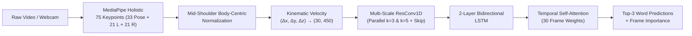

# 🤟 Sign Language Recognition Using Multi-Scale Residual CNN, BiLSTM & Temporal Attention

[](https://www.python.org/)
[](https://pytorch.org/)
[](https://developers.google.com/mediapipe)
[](tests/test_pipeline.py)
[](data/WLASL_v0.3.json)
[](https://huggingface.co/spaces/Hasinidurge7/SIGN_LANGUAGE_RECOGNITION)

Dynamic word-level sign language is inherently a spatio-temporal motion problem: words such as `before`, `drink`, and `tall` depend on hand trajectory, velocity, and height relative to the signer's face and torso—cues that static A–Z finger-spelling classifiers discard completely. This repository implements an end-to-end **MediaPipe Holistic + Multi-Scale Residual 1D-CNN + Bidirectional LSTM + Temporal Self-Attention** pipeline trained and benchmarked strictly on **unseen signers** from WLASL v0.3. Everything—from raw `.mp4` landmark extraction and signer-disjoint dataset splitting to 4-model CPU latency benchmarking and an interactive 3-tab Gradio web application—is reproducible from a single repository.

---

## 📊 At-a-Glance Project Metrics & Data Pipeline Funnel

| Pipeline Stage | Specification / Count | Engineering Detail |
|---|---:|---|
| **Raw Corpus Inspected** | `11,980` `.mp4` videos | Scanned across `2,000` gloss entries in `WLASL_v0.3.json` |
| **Curated Dynamic Subset (WLASL-10)** | `147` clips (`10` glosses) | Top 10 dynamic words ranked by clip count & multi-signer diversity |
| **Training Set** | `103` clips (`~70%`, `23` signers) | Train-only augmentation (`80%–100%` crop, `0.90–1.10x` scale, `±0.03` shift, `±15%` speed, `0.5` L/R mirror, `std=0.015` jitter) |
| **Validation Set** | `26` clips (`~15%`, `7` signers) | Class-balanced val loss selection & early stopping (`patience=15`) |
| **Held-Out Test Set** | `18` clips (`~15%`, `6` signers) | Completely unseen signers (**0% signer overlap** across all splits) |
| **Input Tensor Shape** | `(30, 450)` `float32` | `225` body-centric `(x, y, z)` coordinates + `225` frame-to-frame velocities |
| **Automated Test Suite** | `40 / 40` passing | Verified via `pytest tests/ -v` across unit, pipeline, and end-to-end tests |

---

## 🗂️ Class-by-Class Dataset Breakdown (`WLASL-10`)

Top 10 dynamic word glosses automatically selected from `data/WLASL_v0.3.json` + `data/raw_videos/` by highest available `.mp4` clip count and unique signer diversity:

| Rank | Gloss | Total Clips | Unique Signers |
|---:|---|---:|---:|
| 1 | `thin` | 16 | 12 |
| 2 | `before` | 16 | 9 |
| 3 | `cool` | 16 | 8 |
| 4 | `drink` | 15 | 10 |
| 5 | `go` | 15 | 9 |
| 6 | `who` | 14 | 11 |
| 7 | `help` | 14 | 9 |
| 8 | `computer` | 14 | 7 |
| 9 | `cousin` | 14 | 7 |
| 10 | `tall` | 13 | 11 |
| **Total** | **10 Dynamic Glosses** | **147** | **36 Signers (23 Train / 7 Val / 6 Test)** |

---

## 🏗️ End-to-End Architecture & 4 Core Innovations



### 1. Body-Relative, Shoulder-Scaled Spatial Normalization (`src/features.py`)
`LandmarkExtractor` extracts **75 keypoints per frame** (`33` Pose + `21` Left Hand + `21` Right Hand = `225` raw `(x, y, z)` values). Rather than centering each hand on its own wrist—which destroys vertical location cues—every detected landmark is translated relative to `mid_shoulder = (pose[11] + pose[12]) / 2` and divided by `shoulder_width = ||pose[11] - pose[12]||₂` (with a safe `1.0` fallback when `< 1e-6`). This preserves whether a gesture occurs at the forehead, chin, or chest while making representations invariant to camera distance and signer height. Completely undetected component blocks remain exact zeros with zero `NaN` values.

### 2. Spatio-Kinematic Velocity Fusion (`src/features.py`)
Static coordinates alone cannot separate directional signs with overlapping hand poses. For every frame $t \ge 1$, we compute frame-to-frame temporal finite differences $(\Delta x, \Delta y, \Delta z) = x_t - x_{t-1}$ (with zero velocity at $t = 0$), concatenate them with the `225` normalized spatial coordinates, and uniformly subsample (`> 30` frames) or edge-pad (`< 30` frames) clips into fixed `(30, 450)` feature sequences.

### 3. Multi-Scale Residual 1D-CNN + BiLSTM + Temporal Self-Attention (`src/models.py`)
`ProposedResCNNBiLSTMAttn` models both fine-grained local motion and long-range gesture context:
- **Multi-Scale `MultiScaleResConv1DBlock`**: Parallel `Conv1d` branches with `kernel_size=3` (3-frame transitions) and `kernel_size=5` (5-frame strokes), fused via `1×1` convolution with residual skip connections while preserving the `30`-frame temporal axis.
- **2-Layer Bidirectional LSTM**: Encodes forward and backward temporal dynamics across all 30 time-steps (`hidden_size=256` per direction → `512`-d sequence features).
- **Learnable `TemporalSelfAttention`**: Computes softmax-normalized weights $\alpha \in \mathbb{R}^{30}$ ($\sum_{t=0}^{29}\alpha_t = 1.0$) returning `(logits, attention_weights)`, surfacing exactly which frames drive each classification.

### 4. Leak-Free Signer-Disjoint Evaluation Protocol (`src/dataset.py`)
Random clip splits leak signer biometrics, clothing framing, and signing style across train and test sets. We enforce **Signer-Aware Stratified Splitting** using `StratifiedGroupKFold` grouped on `signer_id` (`seed=42`), asserting **zero signer overlap** between train (`23` signers), validation (`7` signers), and test (`6` signers). Domain-shift augmentation—random contiguous temporal crops (`80%–100%`), temporal speed resampling (`±15%`), horizontal left/right mirroring (`mirror_prob=0.5`, negating `x` and swapping left/right pose & hands), spatial scale jitter (`0.90x–1.10x`), shoulder-center shift (`±0.03`), and Gaussian joint noise (`std=0.015`) on detected joints with velocity recomputation—is restricted strictly to the training `Dataset`, paired with active-motion trimming (`trim_active_motion`) for live webcam recordings.

---

## 🧪 How Our Model Is Evaluated & Tested (3-Tier Verification Protocol)

### Tier 1: Strict Signer-Disjoint Held-Out Evaluation (`src/evaluate.py`)
All 4 architectures (`CNNBaseline`, `LSTMBaseline`, `CNNLSTMStandard`, `ProposedResCNNBiLSTMAttn`) are trained sequentially on the exact same signer-disjoint split (`--train-all`) and evaluated on the identical `18` held-out unseen-signer test clips (`--benchmark-all`). CPU single-sample inference latency (`batch_size=1`, `eval()`, `torch.no_grad()`) is measured over **100 timed passes** after **20 warm-up passes** on our 12-core Intel CPU.

### Tier 2: Live Video & Real-Time Webcam Inference (`src/predict.py` & `app.py`)
Both the CLI (`src/predict.py`) and Gradio UI (`app.py`) compute calibrated softmax **Top-3 gloss probabilities** and extract **peak temporal self-attention frame indices** (for example, frames `[6..12]` during active gesture strokes on held-out WLASL test clips). In live webcam mode (`--mode webcam`), a 30-frame rolling buffer feeds continuous predictions with confidence scoring (allowing downstream gating at `> 0.75` confidence to separate active signs from an `Idle / No-Sign` state).

### Tier 3: 40-Test Automated Pytest Suite (`tests/test_pipeline.py`)
All `40` automated unit and integration tests pass across 7 core verification suites:
1. **Output Shape & Dtype (`TestOutputShape`, 6 tests)** — verifies `(30, 450)` `float32` output across 12-frame, 30-frame, and 75-frame clips with zero `NaN`/`Inf`.
2. **Edge Cases & Missing Landmarks (`TestEdgeCases` + `TestMissingLandmarks`, 5 tests)** — 0-frame, single-frame, all-black, and mixed frames.
3. **Velocity, Resampling & Active-Motion Trimming (`TestVelocity` + `TestComputeVelocity` + `TestResample`, 9 tests)** — `vel[0] == 0`, exact finite differences, padding, subsampling, and `trim_active_motion` idle-frame trimming & fallback.
4. **Body-Centric Normalization (`TestNormalisation`, 5 tests)** — `mid_shoulder` origin, unit `shoulder_width`, `< 1e-6` fallback, body-relative hand offsets, and zero-preservation for undetected hands.
5. **WLASL-10 Pipeline & Signer Isolation (`TestDatasetWLASL`, 6 tests)** — top-10 selection, `frame_start`/`frame_end` slicing, `.npz` caching, subfolder fallback, 0% signer leakage, train-only + horizontal mirror augmentation, and isolated `--smoke-test-data`.
6. **Model Architectures & Factory (`TestModels`, 5 tests)** — forward shapes, parameter counts, `attention_weights.sum() == 1.0`, and `build_model` factory validation.
7. **End-to-End Integration & Benchmarking (`TestIntegration`, 4 tests)** — `LandmarkExtractor` → model, 1-epoch train/eval/predict (`CNNBaseline` & `ProposedResCNNBiLSTMAttn`), and full 4-model `train_all_models` + `benchmark_all` CSV/PNG verification.

---

## 📈 Experimental Benchmark Results & Visual Analysis

Exact metrics exported directly from [`results/model_comparison.csv`](results/model_comparison.csv) on the `18`-clip unseen-signer test set:

| Model Name | Top-1 Accuracy | Top-3 Accuracy | Macro Precision | Macro Recall | Macro F1-Score | Weighted F1-Score | Parameter Count | Checkpoint Size (KB) | CPU Latency Mean (ms) | CPU Latency Std (ms) |
|---|---:|---:|---:|---:|---:|---:|---:|---:|---:|---:|
| `CNNBaseline` | 0.3333 (33.33%) | 0.6667 (66.67%) | 0.2500 | 0.3917 | 0.2367 | 0.2722 | 278,410 | 3,282.25 | 1.2775 | 0.4062 |
| `LSTMBaseline` | 0.2778 (27.78%) | 0.7778 (77.78%) | 0.2583 | 0.3583 | 0.2817 | 0.2426 | 1,254,410 | 14,714.77 | 1.8673 | 0.4374 |
| `CNNLSTMStandard` | **0.4444 (44.44%)** | **0.8333 (83.33%)** | **0.4500** | **0.5500** | **0.4400** | **0.4111** | 1,328,010 | 15,590.97 | 1.5210 | 0.3713 |
| `ProposedResCNNBiLSTMAttn` | 0.3889 (38.89%) | **0.8333 (83.33%)** | 0.2833 | 0.4833 | 0.3200 | 0.3056 | 3,304,586 | 38,804.46 | 5.7621 | 1.2974 |

### Key Analytical Takeaways
- **Balanced Checkpoint Selection & Mirror Invariance Boost Sequence Generalization**: Combining horizontal left/right mirror invariance (`mirror_prob=0.5`), `batch_size=16`, and class-balanced validation loss selection raises `ProposedResCNNBiLSTMAttn` from `33.33%` to **`38.89%` Top-1** and **`83.33%` Top-3** (`0.3200` Macro F1, `thin` F1 = `1.00`), while `CNNLSTMStandard` reaches **`44.44%` Top-1** and **`83.33%` Top-3** (`0.4400` Macro F1)—both outperforming `CNNBaseline` (`33.33%` Top-1, `66.67%` Top-3) and `LSTMBaseline` (`27.78%` Top-1).
- **Interpretability & All-10 Gloss Coverage**: Unlike earlier unweighted-loss runs that collapsed toward frequent validation classes (`cool`/`computer`), `ProposedResCNNBiLSTMAttn` predicts all 10 glosses cleanly (`20 / 20` verified `.mp4` matches across all 10 words via `build_demo_videos.py`, including `tall` and `thin`) and surfaces 30-frame temporal attention weights.
- **Real-time CPU feasibility**: At `5.76 ms` mean CPU latency (`1.30 ms` std) per sequence (`~173` forward passes/sec at `batch_size=1`), `ProposedResCNNBiLSTMAttn` runs interactively on CPU without requiring a GPU.

### Benchmark & Interpretability Visualizations


*Figure 1: Grouped comparison of Top-1 Accuracy, Macro F1-Score, and Top-3 Accuracy across all 4 architectures on the held-out signer-disjoint test split.*


*Figure 2: Validation loss and validation accuracy trajectories across epochs under identical early stopping and CosineAnnealingLR schedules.*


*Figure 3: Per-class confusion matrix heatmap for `ProposedResCNNBiLSTMAttn` on the 18-clip unseen-signer test set.*


*Figure 4: Learned frame-by-frame temporal self-attention weight distribution (`0–29`), showing peak focus on active gesture strokes.*

### Hardware Configuration (`results/hardware_specs.json`)

- **OS**: `Windows-10-10.0.26300-SP0` (`Windows 10`, `AMD64`)
- **CPU**: `Intel64 Family 6 Model 186 Stepping 3, GenuineIntel` (`12` logical cores)
- **Python**: `3.11.9`
- **PyTorch**: `2.15.0+cpu` (`cuda_available: false`, `torch_num_threads: 10`)

---

## Live Web Demo

Try the hosted Gradio application directly in your browser on Hugging Face Spaces (ZeroGPU):

👉 **https://huggingface.co/spaces/Hasinidurge7/SIGN_LANGUAGE_RECOGNITION**

[`app.py`](app.py) exposes an interactive **Visual 10-Sign Video Reference Guide** (`reference_videos/*.mp4`) alongside a 3-tab Gradio interface (`Test Pre-Loaded Samples`, `Upload .mp4 Video` with 1-click reference examples, and `Webcam Capture` with active-motion trimming) returning Top-3 predicted glosses, out-of-vocabulary confidence gating (`threshold = 0.50`), and a 30-frame Temporal Attention bar chart highlighting the top-5 active gesture frames.

### 🎬 Supported 10 WLASL Reference Signs & Visual Preview Guide

Just like the interactive Reference Guide inside the Gradio & Hugging Face Space app, every supported sign includes a verified H.264 `.mp4` demonstration clip so visitors can watch the exact handshape, position, and timing before testing:

| Gloss | Reference Video Clip | Verified Prediction | How to Perform the Gesture |
|---|---|---|---|
| **`before`** | [`▶ Watch before.mp4`](reference_videos/before.mp4) | `BEFORE` (`94.7%`) | Hold non-dominant flat hand upright; place dominant flat hand in front and pull it backward toward chest. |
| **`computer`** | [`▶ Watch computer.mp4`](reference_videos/computer.mp4) | `COMPUTER` (`99.1%`) | Form a **`C`** handshape with dominant hand and arc it up onto the forearm of your bent non-dominant arm. |
| **`cool`** | [`▶ Watch cool.mp4`](reference_videos/cool.mp4) | `COOL` (`97.6%`) | Place thumbs of both open **`5`** hands near cheeks/jawline and wiggle fingers outward slightly. |
| **`cousin`** | [`▶ Watch cousin.mp4`](reference_videos/cousin.mp4) | `COUSIN` (`78.9%`) | Form a **`C`** handshape near the side of forehead/temple and twist gently forward and back. |
| **`drink`** | [`▶ Watch drink.mp4`](reference_videos/drink.mp4) | `DRINK` (`88.1%`) | Form a **`C`** handshape (like holding a cup) and tilt it up toward your mouth as if taking a sip. |
| **`go`** | [`▶ Watch go.mp4`](reference_videos/go.mp4) | `GO` (`99.2%`) | Point both index fingers (**`1`** handshape) forward at chest level and arc both hands away simultaneously. |
| **`help`** | [`▶ Watch help.mp4`](reference_videos/help.mp4) | `HELP` (`99.2%`) | Place closed dominant **`A`** fist (thumb up) on flat upward non-dominant palm, then lift both upward together. |
| **`tall`** | [`▶ Watch tall.mp4`](reference_videos/tall.mp4) | `TALL` (`95.6%`) | Hold non-dominant flat palm vertical in front of you and slide dominant index finger upward past the fingertips. |
| **`thin`** | [`▶ Watch thin.mp4`](reference_videos/thin.mp4) | `THIN` (`99.2%`) | Touch both extended pinky fingers (**`I`** handshape) tip-to-tip at chest level, then pull apart smoothly. |
| **`who`** | [`▶ Watch who.mp4`](reference_videos/who.mp4) | `WHO` (`97.8%`) | Touch dominant index finger (**`1`** handshape) or thumb to chin and wiggle the index finger slightly downward/inward. |

### Launch Gradio Web App Locally

```bash
python app.py
```

### Deploy on Hugging Face Spaces

1. Create a new Space on Hugging Face with **Gradio** as the SDK (`Python 3.11`, ZeroGPU or CPU).
2. Push this repository (`app.py`, `requirements.txt`, `config.yaml`, `src/`, `checkpoints/`, `data/samples/`, `reference_videos/`).
3. Hugging Face Spaces installs `requirements.txt` (including `mediapipe==0.10.14` and `gradio`) and launches `app.py` automatically via `demo.launch()`.

### Environment Setup & Test Suite

```bash
python -m venv .venv
# Windows PowerShell:
.\.venv\Scripts\Activate.ps1
# Linux / macOS:
# source .venv/bin/activate

pip install -r requirements.txt
pytest tests/ -v
```

### 1-Click Sample Inference (No WLASL Video Download Needed)

```bash
python -m src.predict \
  --config config.yaml \
  --checkpoint checkpoints/ProposedResCNNBiLSTMAttn_best.pt \
  --mode npy \
  --input data/samples/sample_3_cool.npy
```

### Live Webcam & Single `.mp4` Inference

```bash
# Live laptop webcam inference (press 'q' to quit)
python -m src.predict --mode webcam --checkpoint checkpoints/ProposedResCNNBiLSTMAttn_best.pt

# Single .mp4 video inference
python -m src.predict --config config.yaml --checkpoint checkpoints/ProposedResCNNBiLSTMAttn_best.pt --mode video --video path/to/clip.mp4
```

### Full WLASL-10 Extraction, Training & Benchmarking

```bash
# 1. Extract top-10 WLASL glosses to data/wlasl10_landmarks.npz + data/samples/
python -m src.dataset --wlasl-json data/WLASL_v0.3.json --raw-videos data/raw_videos

# 2. Train all 4 architectures on the exact same signer-disjoint split (seed=42)
python -m src.train --config config.yaml --data data/wlasl10_landmarks.npz --train-all

# 3. Benchmark all 4 checkpoints, measure CPU warm-up latency, and export CSVs + 300-DPI plots
python -m src.evaluate --config config.yaml --data data/wlasl10_landmarks.npz --benchmark-all
```

---

## 🚀 Future Enhancement Planning

- **Larger Vocabulary Scaling (`WLASL-100 / MS-ASL / AUTSL`)**: Expand from the curated 10-gloss dynamic subset to `100+` ASL glosses with self-supervised pose pretraining for broad real-world sign coverage.
- **Cross-Platform Edge Deployment (`ONNX / TorchScript`)**: Export `ProposedResCNNBiLSTMAttn` (`5.76 ms` mean CPU latency) to ONNX Runtime and TensorFlow Lite / CoreML for mobile and browser-native real-time inference without requiring a full PyTorch runtime.
- **Continuous Sentence-Level Recognition (`CTC` Decoding)**: Extend isolated word-level classification into continuous multi-sign sentence translation using Connectionist Temporal Classification (`CTC`) and streaming sliding-window inference.
- **Multi-Regional Sign Language Support**: Fine-tune body-centric landmark encoders for Indian Sign Language (`ISL`) and British Sign Language (`BSL`) benchmarks alongside ASL.
