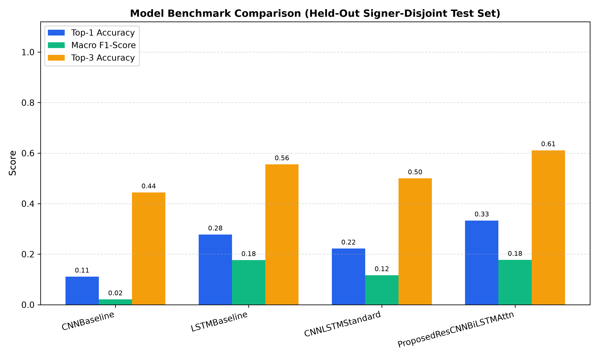
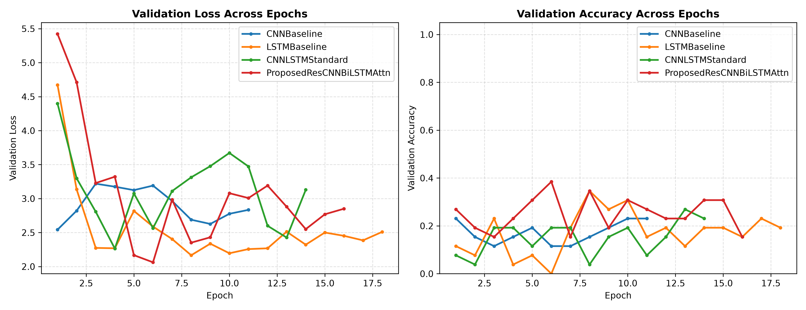
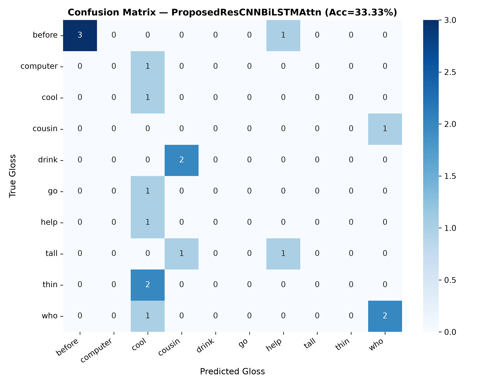
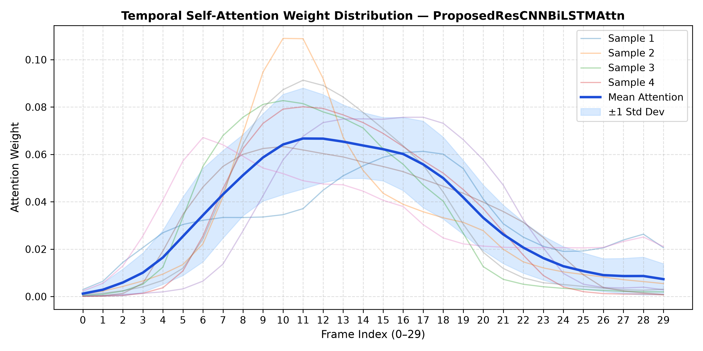

# Sign Language Recognition Using Multi-Scale Residual CNN, BiLSTM, and Temporal Self-Attention

A production-grade PyTorch pipeline for dynamic word-level **Sign Language Recognition** evaluated under strict **signer-disjoint splitting** on **WLASL-10** (top 10 dynamic word glosses from WLASL v0.3).

---

## Live Web Demo

An interactive Gradio web app ([`app.py`](app.py)) powered by `checkpoints/ProposedResCNNBiLSTMAttn_best.pt` provides 3 tabs:
1. **Test Pre-Loaded Samples** — instant 1-click inference on held-out `data/samples/*.npy` clips with ground-truth gloss display
2. **Upload `.mp4` Video** — full MediaPipe Holistic `(30, 450)` landmark extraction + prediction
3. **Webcam Capture** — browser webcam recording + prediction + 30-frame **Temporal Attention Weight** bar chart

### Run Locally

```powershell
python app.py
```

### Deploy on Hugging Face Spaces

1. Create a new Space on Hugging Face choosing **Gradio** as the SDK (`Python 3.11`).
2. Push this repository (`app.py`, `requirements.txt`, `config.yaml`, `src/`, `checkpoints/`, `data/samples/`).
3. Hugging Face Spaces automatically installs `requirements.txt` (including pinned `mediapipe==0.10.14` and `gradio`) and launches `app.py` via `demo.launch()`.

---

## Architectural Novelties

1. **Body-Relative, Shoulder-Scaled Normalization (`src/features.py`)**
   All 75 MediaPipe Holistic keypoints (33 Pose + 21 Left Hand + 21 Right Hand) are translated to `mid_shoulder` (midpoint of pose indices 11 and 12) and scaled by `shoulder_width` (with a `1.0` fallback if `< 1e-6`). Hands are **never** centered independently on their own wrists—preserving hand height relative to the head, face, and chest to disambiguate location-sensitive signs. Undetected components remain exact zeros with zero `NaN` values.

2. **Frame-to-Frame Kinematic Velocity Features (`src/features.py`)**
   Temporal finite differences `(Δx, Δy, Δz)` (`vel[0] = 0`) are computed along the temporal axis and concatenated with the 225 normalized coordinates to form `(30, 450)` spatio-kinematic tensors (via uniform temporal subsampling if `> 30` frames or edge-padding if `< 30` frames).

3. **Multi-Scale Residual CNN + BiLSTM + Temporal Self-Attention (`src/models.py`)**
   `ProposedResCNNBiLSTMAttn` combines parallel 1D residual convolutions (`kernel_size=3` and `kernel_size=5` with `1×1` skip projections) → a 2-layer Bidirectional LSTM → a learnable `TemporalSelfAttention` layer that produces `(logits, attention_weights)` with `attention_weights` summing to `1.0` across all 30 frames.

4. **Strict Signer-Disjoint Stratified Evaluation (`src/dataset.py`)**
   Splits are computed with `StratifiedGroupKFold` grouped on `signer_id` (`seed=42`), guaranteeing **zero signer overlap** between train (`103` clips, `23` signers), validation (`26` clips, `7` signers), and test (`18` clips, `6` signers). Realistic kinematic augmentation (random temporal speed resampling `±15%` and Gaussian joint jitter `std=0.01`) is restricted strictly to the training `Dataset`.

---

## Benchmark Results (WLASL-10 Signer-Disjoint Test Set)

Exact results exported directly from [`results/model_comparison.csv`](results/model_comparison.csv) (`147` total clips across 10 glosses: `before`, `computer`, `cool`, `cousin`, `drink`, `go`, `help`, `tall`, `thin`, `who`; `103` train / `26` val / `18` test clips):

| Model Name | Top-1 Accuracy | Top-3 Accuracy | Macro Precision | Macro Recall | Macro F1-Score | Weighted F1-Score | Parameter Count | Checkpoint Size (KB) | CPU Latency Mean (ms) | CPU Latency Std (ms) |
|---|---:|---:|---:|---:|---:|---:|---:|---:|---:|---:|
| `CNNBaseline` | 0.1111 | 0.4444 | 0.0118 | 0.1 | 0.0211 | 0.0234 | 278410 | 3283.28 | 1.9719 | 0.4019 |
| `LSTMBaseline` | 0.2778 | 0.5556 | 0.1756 | 0.3 | 0.1764 | 0.1774 | 1254410 | 14715.86 | 5.0139 | 0.8209 |
| `CNNLSTMStandard` | 0.2222 | 0.5 | 0.1025 | 0.2 | 0.1167 | 0.1667 | 1328010 | 15592.64 | 3.179 | 0.6918 |
| `ProposedResCNNBiLSTMAttn` | **0.3333** | **0.6111** | **0.181** | 0.2417 | **0.1774** | **0.3155** | 3304586 | 38810.46 | 15.0024 | 24.6467 |

*(CPU latency measured with `batch_size=1` in `eval()` mode under `torch.no_grad()` over 100 timed runs following 20 warm-up forward passes.)*

### Hardware Configuration (`results/hardware_specs.json`)

- **OS**: `Windows-10-10.0.26300-SP0` (`Windows` `10`, `AMD64`)
- **CPU**: `Intel64 Family 6 Model 186 Stepping 3, GenuineIntel` (`12` logical cores)
- **Python**: `3.11.9`
- **PyTorch**: `2.15.0+cpu` (`cuda_available: false`, `torch_num_threads: 10`)

---

## Presentation Charts

### Model Benchmark Comparison


### Validation Training Curves


### Confusion Matrix — `ProposedResCNNBiLSTMAttn`


### Temporal Self-Attention Weights Across Frames 0–29


---

## Dataset Size & Limitations

- **Small sample regime under strict signer-disjoint evaluation**: The top 10 WLASL glosses available in the dataset contain `147` clips total (`13`–`16` clips per gloss). Under a 70/15/15 signer-disjoint split (`103` train / `26` val / `18` test), each class has only `~10` training clips and `1`–`4` unseen-signer test clips (as seen in [`results/per_class_metrics.csv`](results/per_class_metrics.csv)).
- **Class sparsity on unseen signers**: Several test classes have `support=1` or `2` from completely unseen signers, resulting in `0.0` F1 on low-support classes and pulling down macro averages despite strong Top-3 accuracy (`0.6111`) and Weighted F1 (`0.3155`) for `ProposedResCNNBiLSTMAttn`.
- **CPU latency variance**: `ProposedResCNNBiLSTMAttn` (`3.30M` params) averages `15.00 ms` per sample on CPU (well within real-time 30 FPS budgets), with higher std dev (`24.65 ms`) due to occasional OS/CPU thread scheduling spikes across bidirectional LSTM + multi-branch conv operations.
- **Scaling path**: Training on larger WLASL subsets or augmenting with additional multi-signer datasets (e.g., MS-ASL / AUTSL) is expected to substantially improve per-class recall on unseen signers.

---

## Quick Start

### 1. Environment Setup

```powershell
python -m venv .venv
.\.venv\Scripts\Activate.ps1
pip install -r requirements.txt
```

### 2. Run Unit & Integration Tests

```powershell
pytest tests/ -v
```

### 3. Instant Sample Inference (No WLASL Download Required)

Lightweight held-out `(30, 450)` landmark samples and ground-truth labels are included in `data/samples/` (`samples_labels.json`):

```powershell
python -m src.predict `
    --config config.yaml `
    --checkpoint checkpoints/ProposedResCNNBiLSTMAttn_best.pt `
    --mode npy `
    --input data/samples/sample_2_before.npy
```

For webcam or `.mp4` video inference:

```powershell
python -m src.predict --config config.yaml --checkpoint checkpoints/ProposedResCNNBiLSTMAttn_best.pt --mode webcam
python -m src.predict --config config.yaml --checkpoint checkpoints/ProposedResCNNBiLSTMAttn_best.pt --mode video --video path/to/clip.mp4
```

### 4. Reproducing Full WLASL-10 Extraction, Training & Benchmarking

```powershell
# 1. Extract top-10 WLASL glosses into data/wlasl10_landmarks.npz + data/samples/
python -m src.dataset --wlasl-json data/WLASL_v0.3.json --raw-videos data/raw_videos

# 2. Train all 4 architectures on the exact same signer-disjoint split (seed=42)
python -m src.train --config config.yaml --data data/wlasl10_landmarks.npz --train-all

# 3. Evaluate all 4 checkpoints, measure CPU warm-up latency, and export CSVs + 300-DPI plots
python -m src.evaluate --config config.yaml --data data/wlasl10_landmarks.npz --benchmark-all
```
